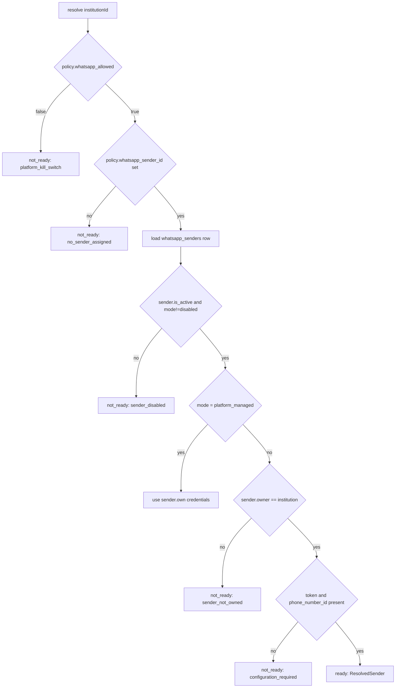
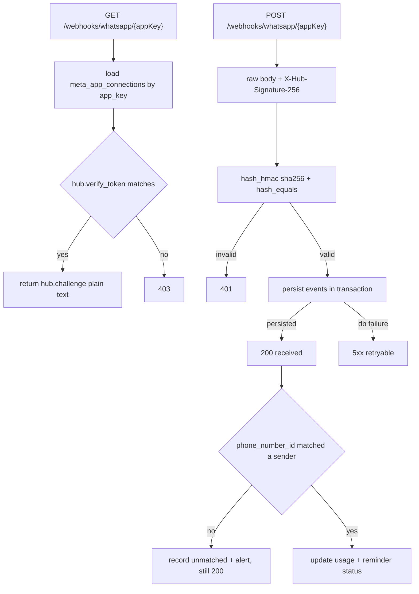

# Implementation Plan v2.1 — Per-Institution WhatsApp Integration (FINAL)

Status: **final architecture document**. Supersedes v1 and v2.
This is the document to approve. Do not produce v3.
No source code, migrations, or schema changes have been made.

Review history: v1 7.5/10 → v2 8.5/10 → v2.1 addresses all 12 corrections plus
the ownership/management/assignment split.

---

## 0. Change log (v2 → v2.1)

| # | v2 defect | v2.1 resolution | Severity |
| --- | --- | --- | --- |
| 1 | Platform-managed sender had no credential home | `whatsapp_senders` with nullable `owner_institution_id`; platform sender is a row | P0 |
| 2 | Date-based grandfathering (non-compliant) | Evidence-based migration only; unknown = `pending` = blocked | P0 |
| 3 | Events could not compute the 24h window | `integration_id` + `contact_wa_id`; integration-aware unique key | P0 |
| 4 | Idempotency key mutated per attempt | Stable `delivery_intent_key` + `attempt_number` + `submission_unknown` | P0 |
| 5 | Quota and Meta cost conflated | Separate quota lifecycle vs. rate-card snapshot and billable cost | P0 |
| 6 | Ownership, management, assignment conflated | Three distinct columns/concepts (§2) | P0 |
| 7 | Consent lacked business identity + category | `whatsapp_consents` scoped by sender + category | P1 |
| 8 | "Sent" used for `submitted` | Distinct ladder incl. `submission_unknown` | P1 |
| 9 | Generated column vs. model events ambiguous | MySQL 8 stored generated column only | P1 |
| 10 | "4 tables" claim wrong | Explicit 7-table count with phase timing | P1 |
| 11 | Activation precedence undefined | Explicit precedence order (§3.5) | P1 |
| 12 | Webhook DB-failure semantics absent | If persistence fails, return retryable 5xx | P1 |
| 13 | Quota timezone assumed | `quota_timezone` column + documented migration default | P1 |
| 14 | Estimated cost presented as fact | Rate-card snapshot table; estimated never equals billed | P1 |
| 15 | Implied exactly-once delivery | Explicitly not promised; reconciliation required | P0 |

---

## 1. Core principle

> One institution = one messaging identity, its own credentials, permissions,
> consent records, quota and delivery history. No silent sender substitution, ever.

Corollary: **delivery is at-least-once with reconciliation, never exactly-once.**
A network timeout after Meta accepts a message is inherently ambiguous. The
system must be able to *detect and resolve* that ambiguity, not pretend it
cannot occur.

---

## 2. The three separate concepts (ownership / management / assignment)

These were conflated in v2 and are the central correction of v2.1.

| Concept | Column | Values | Question answered |
| --- | --- | --- | --- |
| **Sender ownership** | `whatsapp_senders.owner_institution_id` | `NULL` = platform-owned shared; `institution_id` = institution-owned | Whose brand/number is this? |
| **Credential management** | `whatsapp_senders.managed_by` | `platform` \| `institution` | Who may edit the credentials? |
| **Sender assignment** | `integration_policies.whatsapp_sender_id` | FK to a sender | Which sender does this institution actually use? |

Examples that prove they are independent:

- Platform admin configures School A's own number.
  → owner = A, managed_by = platform, assigned to A. Platform holds the token;
  the sender is still A's.
- School B self-configures its own number.
  → owner = B, managed_by = institution, assigned to B.
- Two small institutions share the platform sender.
  → owner = NULL, managed_by = platform, assigned explicitly to both.

Rules:

- A platform-owned shared sender is used **only** by institutions with an
  explicit `integration_policies.whatsapp_sender_id` pointing at it.
- There is **no implicit assignment** and **no automatic fallback**. An
  institution with no assigned sender does not send.
- `managed_by` controls the API/UI permission, not the branding.

---

## 3. Data model (7 tables)

Table count by phase — stated explicitly (corrects v2's "4 tables" error):

| Table | Phase | Kind |
| --- | --- | --- |
| `meta_app_connections` | A | App-level (platform) |
| `whatsapp_senders` | A | Sender-level (tenant or platform) |
| `integration_policies` | A | Tenant policy |
| `whatsapp_consents` | A | Tenant consent |
| `whatsapp_usage` | A | Tenant accounting |
| `whatsapp_message_events` | A | Provider events |
| `whatsapp_rate_cards` | A | Pricing reference |
| `integration_templates` | D | Templates (required before proactive sends) |

Seven tables in Phase A, eight after Phase D. Template management is **deferred
to Phase D but mandatory before production proactive WhatsApp delivery.**

### 3.1 `meta_app_connections` (app-level, platform)

Holds **only** Meta application identity, never a business sender.

| Column | Type | Notes |
| --- | --- | --- |
| `id` | bigint | |
| `app_key` | string(64) unique | URL segment for webhooks, e.g. `default` |
| `app_id` | string(64) | Meta app id |
| `app_secret` | text encrypted | POST signature verification |
| `verify_token` | text encrypted | GET handshake |
| `is_active` | boolean | |
| `timestamps` | | |

One Meta app can serve many WABAs and phone numbers. Start with one row
(`app_key = default`).

### 3.2 `whatsapp_senders` (sender-level)

This table replaces v2's `institution_integrations`.

| Column | Type | Notes |
| --- | --- | --- |
| `id` | bigint | |
| `owner_institution_id` | FK nullable, cascade | `NULL` = platform-owned shared |
| `meta_app_connection_id` | FK nullable | which Meta app carries this sender |
| `managed_by` | string(16) | `platform` \| `institution` |
| `label` | string(100) | human name, e.g. "Al-Noor Main Number" |
| `connection_mode` | string(24) | `platform_managed` \| `institution_managed` \| `disabled` |
| `phone_number_id` | string(64) nullable | Meta sender id |
| `business_account_id` | string(64) nullable | WABA id |
| `display_phone_number` | string(32) nullable | for UI only, not sending |
| `access_token` | text encrypted nullable | system-user token |
| `token_expiry_mode` | string(16) | `known` \| `never` \| `unknown` |
| `token_expires_at` | timestamp nullable | required when mode = `known` |
| `default_country_code` | string(4) | `92` |
| `is_active` | boolean | operational on/off |
| `active_unique` | string(96) **generated stored** | see below |
| `last_verified_at` | timestamp nullable | credential check only |
| `last_error` | text nullable | redacted |
| `timestamps`, `softDeletes` | | |

**Soft-delete-safe uniqueness (MySQL 8, no partial indexes).** Use a stored
generated column, not model events:

```sql
active_unique VARCHAR(96) AS (
  CASE WHEN deleted_at IS NULL
       THEN CONCAT(COALESCE(owner_institution_id, 0), ':', connection_mode, ':', COALESCE(phone_number_id, ''))
       ELSE NULL
  END
) STORED,
UNIQUE KEY whatsapp_senders_active_unique (active_unique)
```

Laravel: `$table->string('active_unique')->storedAs('...')->nullable();` then
`$table->unique('active_unique')`. Verified: Laravel exposes `storedAs()` and the
test suite runs MySQL, so this works in tests as well as production.

`token_expiry_mode` resolves ChatGPT's point: a `NULL` expiry is not three things
at once. `never` = explicitly no expiry; `unknown` = we were not told; `known` =
must have a date.

### 3.3 `integration_policies` (tenant)

| Column | Type | Notes |
| --- | --- | --- |
| `id` | bigint | |
| `institution_id` | FK unique | |
| `whatsapp_allowed` | boolean default true | platform kill-switch |
| `whatsapp_self_service` | boolean default false | institution may edit own sender |
| `whatsapp_sender_id` | FK nullable | **explicit assignment**; null = cannot send |
| `monthly_message_limit` | int nullable | null = unlimited |
| `warn_at_percent` | int default 80 | |
| `quota_timezone` | string(64) default `Asia/Karachi` | documented migration default |

`quota_timezone` exists because neither `institutions` nor `campuses` has a
timezone column (verified). Migration default is explicit and documented, not
assumed silently. A future institution-level timezone can supersede it; until
then this column is authoritative for quota period boundaries.

### 3.4 `whatsapp_consents` (tenant, sender- and category-scoped)

| Column | Type | Notes |
| --- | --- | --- |
| `id` | bigint | |
| `institution_id` | FK | |
| `business_account_id` | string(64) | business identity, stable across number changes |
| `phone` | string(32) | normalised E.164 |
| `message_category` | string(24) | `utility` \| `marketing` \| `authentication` \| `service` |
| `status` | string(16) | `pending` \| `opted_in` \| `opted_out` |
| `source` | string(48) nullable | `admission_form`, `portal`, `import_evidence`, `whatsapp_reply` |
| `consent_version` | string(16) nullable | wording version |
| `evidence_ref` | string(191) nullable | pointer to the form/record proving consent |
| `opted_in_at` | timestamp nullable | |
| `opted_out_at` | timestamp nullable | |
| `timestamps` | | |
| unique | `(institution_id, business_account_id, phone, message_category)` | |

Consent is per business identity and per category: utility fee reminders and
marketing campaigns are separate opt-ins.

### 3.5 `whatsapp_usage` (quota + cost, clearly separated)

| Column | Type | Notes |
| --- | --- | --- |
| `id` | bigint | |
| `institution_id` | FK | |
| `sender_id` | FK nullable | |
| `reminder_id` | FK nullable | exactly one of reminder/notification |
| `notification_id` | FK nullable | |
| `delivery_intent_key` | string(96) | **stable across retries** |
| `attempt_number` | int | increments per submission attempt |
| `idempotency_key` | string(128) unique | `${delivery_intent_key}:${attempt_number}` |
| `provider_message_id` | string(128) nullable | |
| `message_category` | string(24) | four categories |
| `quota_status` | string(16) | `reserved` \| `consumed` \| `released` |
| `delivery_status` | string(16) | see §7 ladder |
| `recipient` | string(32) | |
| `rate_card_id` | FK nullable | **snapshot reference** |
| `estimated_cost` | decimal(12,6) nullable | never presented as billed |
| `estimated_currency` | string(3) nullable | |
| `billed_cost` | decimal(12,6) nullable | only from provider billing import |
| `billed_currency` | string(3) nullable | |
| `period` | string(7) | `YYYY-MM` in `quota_timezone` |
| `submitted_at`, `delivered_at`, `read_at`, `failed_at` | timestamp nullable | |
| `timestamps` | | |
| indexes | `(institution_id, period, quota_status)`, `(delivery_intent_key)`, unique `idempotency_key` | |

**Quota vs. cost lifecycle (P0 #5):**

| Event | Quota | Cost |
| --- | --- | --- |
| Before outbound submit | `reserved` (atomic) | — |
| Meta accepts request | `consumed` | `estimated_cost` from rate card |
| Definite pre-acceptance failure | `released` | none |
| Provider `delivered` webhook | unchanged | eligible for `billed_cost` |
| Billing import | unchanged | `billed_cost` populated |

`estimated_cost` is a forecast from a rate-card snapshot and is never labelled a
charge. The Cloud API does not return per-message price, so `billed_cost` only
comes from an explicit billing import or provider statement.

### 3.6 `whatsapp_rate_cards` (pricing reference)

| Column | Type | Notes |
| --- | --- | --- |
| `id` | bigint | |
| `market` | string(8) | e.g. `PK` |
| `message_category` | string(24) | four categories |
| `currency` | string(3) | |
| `unit_price` | decimal(12,6) | |
| `effective_from` | date | |
| `effective_to` | date nullable | |
| `source_note` | string(191) nullable | where the rate came from |
| `timestamps` | | |
| unique | `(market, message_category, effective_from)` | |

Snapshots are appended, never updated in place, so historical estimates remain
explainable.

### 3.7 `whatsapp_message_events` (integration-aware)

| Column | Type | Notes |
| --- | --- | --- |
| `id` | bigint | |
| `integration_id` | FK | **sender id** — required for window scoping |
| `institution_id` | FK nullable | denormalised for fast tenant queries |
| `contact_wa_id` | string(32) | **recipient/sender WhatsApp id — required** |
| `provider_message_id` | string(128) nullable | |
| `direction` | string(8) | `inbound` \| `status` |
| `event` | string(32) | `message`, `accepted`, `sent`, `delivered`, `read`, `failed` |
| `event_meta` | json nullable | minimal metadata; **no message bodies retained** |
| `occurred_at` | timestamp | provider timestamp |
| `timestamps` | | |
| unique | `(integration_id, provider_message_id, event, occurred_at)` | idempotent, out-of-order safe |

Window derivation (corrects v2):

```
window_open = exists inbound event where
    integration_id = sender used for this send
    AND contact_wa_id = E.164(recipient)
    AND occurred_at >= now() - 24h
```

Both sender and recipient are required, so School A and School B never share a
window for the same guardian phone number. Message bodies are not stored —
only the metadata needed for the window and receipts.

### 3.8 `integration_templates` (Phase D, mandatory before proactive sends)

| Column | Type | Notes |
| --- | --- | --- |
| `id` | bigint | |
| `institution_id` | FK | |
| `sender_id` | FK | |
| `purpose` | string(32) | `fee_reminder`, `fee_receipt`, `absence`, `exam`, `admission` |
| `name` | string(64) | Meta template name |
| `language` | string(8) | |
| `approval_status` | string(16) | `pending` \| `approved` \| `rejected` |
| `parameters` | json | ordered parameter map |
| `timestamps` | | |
| unique | `(sender_id, name, language)` | |

Institutions author and approve templates in their own WABA; EduCourt stores the
mapping only.

---

## 4. Credential resolution (stateless, fail-closed)

`SenderResolver::resolve(int $institutionId): ResolvedSender`



Key property: `platform_managed` no longer reaches into a different table. The
platform sender is simply a `whatsapp_senders` row with
`owner_institution_id = NULL`. Blockers 1 is resolved without a lookup hop.

**Activation precedence (corrects v2 ambiguity):**

1. `integration_policies.whatsapp_allowed` — platform kill-switch, highest.
2. `integration_policies.whatsapp_sender_id` — assignment; null blocks sending.
3. `whatsapp_senders.connection_mode` — identity/management path.
4. `whatsapp_senders.is_active` — operational toggle.

A kill-switch or `disabled` results in the WhatsApp channel being **skipped**,
never an ambiguous failure that mutates the reminder's business state.

**Statelessness:** every send resolves from the persisted `institution_id` on the
reminder/notification row. No singleton, no per-request cache of credentials, no
reliance on `TenantContext` in a worker.

---

## 5. Delivery intent, idempotency, and the honest 24h window

### 5.1 Stable intent vs. attempt (corrects v2)

```
delivery_intent_key = "reminder:{id}:guardian:{guardian_id}:whatsapp"
attempt_number      = 1, 2, 3, ...
idempotency_key     = "{delivery_intent_key}:{attempt_number}"
```

- The intent key is stable across retries.
- Quota counts **once per intent**, not per attempt.
- A retry that follows a confirmed failure is a new attempt under the same
  intent.
- A deliberate human resend creates a **new intent** (`...:resend:2`), so it is
  visibly a second message, not a silent duplicate.

### 5.2 `submission_unknown` (new terminal-until-reconciled state)

If the HTTP call times out after the request was written:

- Mark `delivery_status = submission_unknown`.
- **Do not retry automatically.**
- Reconcile via provider receipts (webhook) or a controlled operator action.
- If the webhook later confirms delivery, transition to `delivered`.
- If no confirmation arrives within a configurable window, an operator resolves
  it as `failed` or manually resends (new intent).

Exactly-once external delivery is **not** promised anywhere in this design.
At-least-once plus reconciliation is the contract.

### 5.3 The 24-hour window

`window_open(integration_id, contact_wa_id)` uses only inbound events for that
exact sender and recipient. Proactive notifications:

- Window open → free-form text permitted.
- Window closed → **approved template required**.
- No approved template → send fails with `template_required`, never silently
  downgraded to text.

---

## 6. Consent (evidence-based, corrects v2)

### 6.1 Enforcement

A proactive send requires `whatsapp_consents.status = opted_in` for
`(institution, business_account_id, phone, message_category)`. Otherwise it is
blocked with `no_whatsapp_consent` or `opted_out`.

### 6.2 Migration (not grandfathering)

Date-based grandfathering is removed. Migration is **evidence-based**:

| Existing record | Migrated status |
| --- | --- |
| Phone exists, no consent evidence | `pending` — **blocked** |
| Admission form explicitly authorised school WhatsApp contact | `opted_in` with `source=import_evidence`, `evidence_ref` set |
| Documented consent for a specific category | `opted_in` for that category only |
| Previously opted out | `opted_out` (preserved) |
| New guardian without consent | `pending` — blocked |

Implementation: an operator-run command reads an evidence source (form export or
explicit list). Absent evidence, the status stays `pending`. There is no
date-based bypass anywhere in code.

### 6.3 Withdrawal

- Opt-out accepted from the guardian portal **and** from an inbound WhatsApp
  message containing a recognised opt-out keyword.
- Writes `status=opted_out`, `opted_out_at`, and preserves prior `opted_in_at`
  history (audit trail).
- A later opt-in creates a new consent row / version; it does **not** erase the
  opt-out record.

---

## 7. Status ladder (correction: submitted ≠ sent)

```
queued -> reserved -> submitted -> accepted -> sent -> delivered -> read
                                     \-> failed
                                     \-> submission_unknown
```

UI labels:

| Internal | Display |
| --- | --- |
| `queued` | Queued |
| `reserved` | Quota reserved |
| `submitted` | Submitted to WhatsApp |
| `accepted` | Accepted by WhatsApp |
| `sent` | Sent |
| `delivered` | Delivered |
| `read` | Read |
| `failed` | Failed |
| `submission_unknown` | Delivery status unknown — needs reconciliation |

Existing `fee_reminders.status` (`pending|sent|failed|cancelled`) remains the
business state; provider states live in `whatsapp_usage.delivery_status` plus new
`provider_status`/`provider_message_id` columns on reminder/notification rows.

---

## 8. Webhooks

### 8.1 Verification



Correction from review: a valid signature with an unknown `phone_number_id` is
acknowledged (200) **after** durable persistence. If persistence itself fails,
return a retryable 5xx — never acknowledge an event that was lost.

### 8.2 Idempotency and ordering

Unique `(integration_id, provider_message_id, event, occurred_at)` makes
duplicate deliveries harmless. Events are applied via a monotonic state
transition (never downgrade `read` → `sent`), so out-of-order arrival is safe.

---

## 9. Permissions and routes

Permission module `integration`: `view`, `edit`, `test`, `manage`.

| Role | Grants |
| --- | --- |
| `platform_admin` | `integration.*` |
| `campus_admin` | `integration.view`, `integration.edit`, `integration.test` |
| `it_administrator` | `integration.view`, `integration.edit`, `integration.test` |
| `institution_head` | `integration.view` |

Add `it_administrator` to `RoleName::twoFactorRequired()` (it now holds secrets).

Self-service gate: institution `edit` requires `whatsapp_self_service = true`
**and** the sender's `managed_by = institution`; otherwise platform admin only.

### Institution-scoped (`auth:sanctum`, `tenant`)

```
GET  /api/v1/integrations/whatsapp            integration.view
PUT  /api/v1/integrations/whatsapp            integration.edit
POST /api/v1/integrations/whatsapp/verify     integration.test   (credentials only)
POST /api/v1/integrations/whatsapp/test-send  integration.test   (real message)
GET  /api/v1/integrations/whatsapp/usage      integration.view
```

### Platform-scoped (`role:platform_admin`, `integration.manage`)

```
GET|PUT /api/v1/platform/institutions/{institution}/integration-policy
GET|PUT /api/v1/platform/whatsapp-senders
GET|PUT /api/v1/platform/whatsapp-senders/{sender}
POST    /api/v1/platform/whatsapp-senders/{sender}/verify
POST    /api/v1/platform/whatsapp-senders/{sender}/test-send
GET|PUT /api/v1/platform/meta-apps
GET     /api/v1/platform/whatsapp-rate-cards
```

`verify` and `test-send` are separate operations: credential validity does not
prove deliverability.

### Webhooks (public, signature-verified)

```
GET|POST /api/v1/webhooks/whatsapp/{appKey}
```

---

## 10. Migration sequence

Order matters for foreign keys and the generated column.

1. `create_meta_app_connections_table`
2. `create_whatsapp_senders_table` (FK meta_app; generated `active_unique`)
3. `create_integration_policies_table` (FK sender nullable — added after senders)
4. `create_whatsapp_rate_cards_table`
5. `create_whatsapp_consents_table`
6. `create_whatsapp_message_events_table`
7. `create_whatsapp_usage_table` (FK sender, rate card, reminder, notification)
8. `add_provider_tracking_to_fee_reminders_and_app_notifications`
9. `create_integration_templates_table` (Phase D)
10. Data migration (separate, reversible command — not a schema migration):
    create `meta_app_connections.default` from `WHATSAPP_*` env, create a
    platform-owned sender row, assign existing institutions that explicitly opt
    in. No institution is assigned by default.

Existing `.env` credentials are **not deleted**; they become a one-time input to
the data migration, then the source of truth is the database.

---

## 11. Failure-recovery matrix

| Failure | Detected by | State | Automatic action | Operator action |
| --- | --- | --- | --- | --- |
| Token missing (institution-managed) | resolver | `not_ready` | skip channel, notify admins | configure sender |
| Token expired (`known`) | resolver + nightly check | `not_ready` | warn at threshold, skip send | rotate token |
| Token expiry unknown (`unknown`) | resolver | ready + warning banner | none | set expiry |
| Platform kill-switch off | resolver | skipped | none | re-enable policy |
| No sender assigned | resolver | skipped | none | assign sender |
| Sender disabled | resolver | skipped | none | enable sender |
| No consent | generation/send | blocked | mark `no_whatsapp_consent` | collect consent |
| Opted out | generation/send | blocked | mark `opted_out` | obey; no override |
| Window closed, no template | send | blocked | `template_required` | approve template |
| Quota exhausted | reservation | blocked | `quota_exceeded` | raise limit |
| HTTP timeout after write | client | `submission_unknown` | **no retry** | reconcile via receipts |
| Meta rejects (131047/131026/132000) | client | `failed` + reason | none | fix template/number |
| Webhook signature invalid | controller | rejected | 401 | investigate |
| Webhook DB persist failure | controller | none | return 5xx | provider retries |
| Unknown `phone_number_id` | controller | recorded | 200 + alert | map sender |
| Duplicate webhook event | unique key | ignored | none | none |
| Out-of-order event | monotonic transition | ignored downgrade | none | none |

---

## 12. Phases

Standard gates per phase: `php -l`, targeted `php artisan test`,
`./vendor/bin/pint`; web `tsc --noEmit` + `eslint` + `next build` where web
changes. Commit/push to `master`.

- **Phase A — Schema.** Migrations 1-8 above, models (encrypted casts, hidden
  secrets, `LogsActivity` excluding secrets), relationships.
  Tests: tenant isolation, encryption at rest, resource hides secrets,
  generated-column unique, restore-after-delete with an existing active row,
  concurrency insert.
- **Phase B — Resolution engine.** `ResolvedSender`, `SenderResolver`, remove
  env fallback from WhatsApp path, per-institution resolution in
  `ReminderService`/`NotificationService`.
  Tests: A→A, B→B, no fallback, no-sender-assigned blocked, kill-switch,
  concurrent A/B under one worker.
- **Phase C — Consent, intent, quota.** Consent enforcement, evidence
  migration command, delivery intent + attempt, quota reserve/consume/release,
  `submission_unknown`.
  Tests: no-consent blocked, opted-out blocked, retry does not double-count,
  quota correct under concurrency, unknown submission not retried, new intent
  for resend.
- **Phase D — Templates and window.** `integration_templates`, window check,
  template-required failure, Meta error mapping.
  Tests: proactive uses template, window-open uses text, param mismatch error.
- **Phase E — API and UI.** Controllers, self-service gate, Settings UI with
  write-only secrets, verify vs. test-send, token expiry warning, read-only
  banner, i18n regeneration.
  Tests: IT admin cross-institution 403, platform admin allowed,
  `institution_head` write 403, self-service off 403, secret never echoed.
- **Phase F — Webhooks and receipts.** GET verify, POST signature, idempotent
  events, monotonic transitions, 5xx on persistence failure.
  Tests: valid/invalid signature, duplicate/out-of-order events, unknown
  sender 200 + alert, persistence failure 5xx.
- **Phase G — Token lifecycle.** Expiry modes, rotation audit, non-destructive
  reconnect.
  Tests: expired reported, rotation logged without secrets.
- **Phase H — Rollout.** Data migration, per-institution onboarding, docs.
  Rollout: assign senders explicitly one institution at a time; verify then
  test-send before enabling reminders.

---

## 13. Acceptance tests (final)

1. School A sends through A's number.
2. School B sends through B's number.
3. A disabled sender never uses another sender.
4. No assigned sender ⇒ send blocked, clear reason.
5. A queue worker cannot reuse another institution's token.
6. Platform admin manages any institution/sender.
7. IT administrator cannot edit another institution.
8. Institution head is read-only.
9. Self-service off blocks institution-level edits.
10. Tokens and app secrets never in responses or logs.
11. Expired token detected; expiry `unknown` surfaces a warning, not a block.
12. Reminder without consent blocked.
13. Opted-out guardian never receives proactive messages.
14. Out-of-window reminder uses an approved template.
15. Window-closed without template fails `template_required`.
16. Template parameter mismatch yields an actionable error.
17. Retry after timeout does not double-send or double-count.
18. `submission_unknown` is never auto-retried.
19. Quota correct under concurrent jobs.
20. Quota period uses `quota_timezone`, verified across a month boundary.
21. Webhook signature verification works; invalid signature 401.
22. Webhook persistence failure returns 5xx (no lost event).
23. Unknown `phone_number_id` recorded + 200 + alert.
24. Duplicate and out-of-order webhook events handled safely.
25. `delivered`/`read` never shown without a provider event.
26. Create integration after soft delete succeeds; restore collides safely.
27. Rate-card estimate and billed cost are distinct; estimate never shown as
    charged.
28. Consent withdrawal from portal and from inbound keyword both recorded with
    history preserved.

---

## 14. Risks

| Risk | Mitigation |
| --- | --- |
| Silent sender substitution | Explicit assignment; no fallback; tests 3-4 |
| Wrong-institution window | Integration-aware events; §5.3 |
| Duplicate sends on retry | Stable intent + `submission_unknown`; tests 17-18 |
| Non-compliant messaging | Evidence-only consent; tests 12-13 |
| Misleading cost display | Rate-card estimate ≠ billed; test 27 |
| Soft-delete collision | Generated `active_unique`; test 26 |
| Credential bleed in workers | Stateless resolver; test 5 |
| Lost webhook events | 5xx on persistence failure; test 22 |
| Over-modeling | 8 tables, each earning its place; no generic "channel" framework |

Out of scope (documented, not built): SMS/email/push unification. The sender,
consent, usage and event tables are provider-shaped so a future extraction into
a generic messaging core is possible, but no abstraction is introduced now.

---

## 15. Decisions locked

| Decision | Choice |
| --- | --- |
| Consent migration | Evidence-based; unknown = pending = blocked |
| Meta apps | One central app initially; `meta_app_connections` supports many |
| Senders | Platform-owned shared and institution-owned in one table |
| Assignment | Explicit via `integration_policies.whatsapp_sender_id` |
| Cost | Rate-card snapshot estimate, separate `billed_cost` |
| Quota period | Calendar month in `quota_timezone` (default `Asia/Karachi`) |
| Templates | Institution-owned in their WABA |
| Delivery guarantee | At-least-once + reconciliation; never exactly-once |

---

## 16. Approval gate

This is the final architecture document. On approval, implementation starts at
Phase A and proceeds through Phase H. No further redesign (v3) is planned.
