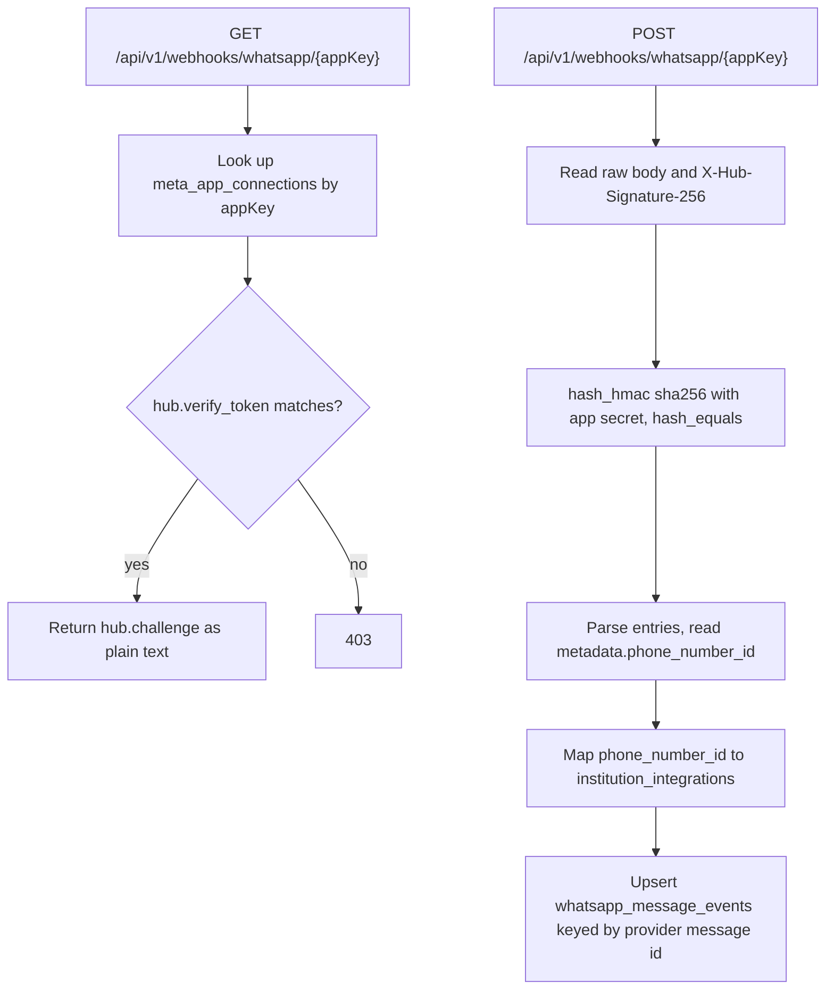

# Implementation Plan v2 — Per-Institution WhatsApp Integration

Status: proposed (supersedes v1 `2026-11-08-per-institution-whatsapp-integration-plan.md`).
Review basis: v1 reviewed at 7.5/10; this revision addresses the P0 findings.
No source code has been written.

---

## 0. What changed from v1 and why

| # | v1 | v2 | Severity |
| --- | --- | --- | --- |
| 1 | Implicit fallback to global `.env` creds | Explicit modes; **fail closed** | P0 |
| 2 | Webhook GET resolved institution by `phone_number_id` | GET verifies app token only; POST resolves tenant from payload | P0 (v1 unimplementable) |
| 3 | No consent model | Consent table + enforcement + backfill strategy | P0 |
| 4 | No usage/quota | Usage ledger, atomic reservation, idempotency | P0 |
| 5 | `app_secret` per phone number | App-level `meta_app_connections` | P0 |
| 6 | `UNIQUE(institution_id, provider)` + soft deletes | Nullable unique-column trick (MySQL 8 has no partial index) | P0 |
| 7 | Ambiguous platform-admin routes | Separate `/platform/...` namespace | P1 |
| 8 | `integration.test` not independently enforced | Dedicated permission per route | P1 |
| 9 | Template fallback to free-form text | Window-aware: never free-form for proactive sends | P1 |
| 10 | Gateway bound as singleton | Stateless factory resolving from persisted `institution_id` | P1 |
| 11 | Delivery receipts optional | Basic receipts + status ladder required | P1 |

Repository facts verified while revising:

- MySQL **8.0.46** (no partial indexes) — confirmed on live server.
- Sending is **synchronous** today: no `app/Jobs`, no `ShouldQueue`, but a
  `queue` pm2 process runs and `QUEUE_CONNECTION=database`.
- `guardians` table has `phone`, `email`, `alternate_phone` — **no consent
  columns**.
- `fee_reminders` / `app_notifications` have **no provider message id** column.
- Existing HMAC precedent: `PaymentService` uses
  `hash_hmac('sha256', $rawBody, $secret)` + `hash_equals`.
- Existing status enums are flat: `pending | sent | failed | cancelled`.
- Live data: 1,203 guardians, 210 reminders (0 WhatsApp), 151 notifications.
  Low volume ⇒ backfill and migration are cheap now, expensive later.

---

## 1. Connection modes (fail-closed) — replaces v1 fallback

`institution_integrations.connection_mode`:

| Mode | Resolve credentials | If unusable |
| --- | --- | --- |
| `platform_managed` | Platform default (app-level `meta_app_connections`) | Mark failed, record reason |
| `institution_managed` | This institution's row | **Never send**; mark failed, flag "configuration required" |
| `disabled` | none | Skip; `ReminderChannel::WhatsApp` send is a no-op failure |

Rules:

- No `.env` reachability from `institution_managed` paths, ever.
- `.env` survives only as the seed for *platform-managed* institutions.
- The resolver returns a **result object**, not a nullable config:

```php
final class ResolvedWhatsAppConnection
{
    public function __construct(
        public readonly bool $ready,
        public readonly ?string $token,
        public readonly ?string $phoneNumberId,
        public readonly ?int $connectionId,
        public readonly ?string $failureReason,
    ) {}
}
```

---

## 2. Webhook architecture (corrected)

Confirming the review: Meta's GET handshake sends only `hub.mode`,
`hub.verify_token`, `hub.challenge`. `phone_number_id` appears only in the POST
`entry[].changes[].value.metadata.phone_number_id`.



Notes:

- The `{appKey}` path segment selects the Meta app (its verify token and secret).
  This is what makes multi-app support possible without ambiguity. If a single
  shared app is used, `{appKey}` can default to `default`.
- POST always returns `200 {"received":true}` after signature verification, even
  for unmatched `phone_number_id` (log + alert, do not 500 — Meta retries).
- Signature uses `hash_equals`, mirroring `PaymentService::verifyWebhook`.

---

## 3. Data model (4 tables now, 3 deferred)

### 3.1 `meta_app_connections` (new, app-level)

| Column | Type | Notes |
| --- | --- | --- |
| `id` | bigint | |
| `app_key` | string(64) unique | URL slug, e.g. `default` |
| `app_id` | string(64) | Meta app id |
| `app_secret` | text encrypted | POST signature |
| `verify_token` | string encrypted | GET handshake |
| `is_active` | boolean | |
| `timestamps` | | |

Platform-owned only; no `institution_id`. Institutions never see secrets.

### 3.2 `institution_integrations` (new)

| Column | Type | Notes |
| --- | --- | --- |
| `id` | bigint | |
| `institution_id` | FK cascade | |
| `provider` | string(32) | `whatsapp` |
| `connection_mode` | string(24) | `platform_managed` / `institution_managed` / `disabled` |
| `meta_app_connection_id` | FK nullable | required for institution-managed |
| `phone_number_id` | string(64) nullable | |
| `business_account_id` | string(64) nullable | WABA |
| `access_token` | text encrypted nullable | |
| `token_expires_at` | timestamp nullable | null = no expiry (warn in UI) |
| `default_country_code` | string(4) | `92` |
| `is_active` | boolean | |
| `active_provider` | string(32) nullable, **unique(institution_id, active_provider)** | soft-delete-safe key: set `NULL` on delete |
| `last_verified_at` | timestamp nullable | credentials check only |
| `last_error` | text nullable | redacted |
| `timestamps`, `softDeletes` | | |

**Soft-delete-safe uniqueness (P0 #6):** do not put `UNIQUE` on
`(institution_id, provider)`. Use a generated-managed nullable column
`active_provider` that equals `provider` while live and is set to `NULL` when
`deleted_at` is set. MySQL allows multiple `NULL`s in a unique index, so a new
row can be created after a soft delete. Implement in the model's `deleting`
event and a `restoring` event.

### 3.3 `integration_policies` (new)

Separates platform policy from integration state (addresses review §3A):

| Column | Type | Notes |
| --- | --- | --- |
| `id` | bigint | |
| `institution_id` | FK unique | |
| `whatsapp_self_service` | boolean default false | |
| `whatsapp_allowed` | boolean default true | platform kill-switch |
| `monthly_message_limit` | int nullable | null = no limit |
| `warn_at_percent` | int default 80 | |
| `timestamps` | | |

Exists independently of an integration row.

### 3.4 `whatsapp_consents` (new)

| Column | Type | Notes |
| --- | --- | --- |
| `id` | bigint | |
| `institution_id` | FK | |
| `guardian_id` | FK nullable | |
| `phone` | string(32) | normalised E.164 at write |
| `status` | string(16) | `pending` / `opted_in` / `opted_out` |
| `source` | string(48) nullable | `admission_form`, `portal`, `import`, `grandfathered` |
| `consent_version` | string(16) nullable | wording version |
| `opted_in_at` | timestamp nullable | |
| `opted_out_at` | timestamp nullable | |
| `timestamps` | | |
| index | `(institution_id, phone)` unique | |

### 3.5 `whatsapp_usage` (new)

Ledger + quota reservation in one table:

| Column | Type | Notes |
| --- | --- | --- |
| `id` | bigint | |
| `institution_id` | FK | |
| `integration_id` | FK nullable | |
| `reminder_id` | FK nullable | or `notification_id` |
| `notification_id` | FK nullable | exactly one of the two set |
| `idempotency_key` | string(64) **unique** | prevents double-count on retry |
| `provider_message_id` | string(128) nullable | |
| `message_category` | string(24) | `utility` / `marketing` / `service` |
| `status` | string(16) | see §7 ladder |
| `recipient` | string(32) | |
| `estimated_cost` | decimal(10,4) nullable | never hardcode a universal price |
| `currency` | string(3) nullable | |
| `period` | string(7) | `YYYY-MM` for monthly roll-up |
| `sent_at`, `delivered_at`, `read_at` | timestamp nullable | |
| `timestamps` | | |
| indexes | `(institution_id, period)`, unique `idempotency_key` | |

Atomic enforcement: inside a DB transaction, `SELECT ... FOR UPDATE` on the
policy row (or a dedicated counter row) before insert; abort when
`count(period) >= monthly_message_limit`.

### 3.6 `whatsapp_message_events` (new)

Raw provider events, audit trail, and the source of truth for the 24h window:

| Column | Type | Notes |
| --- | --- | --- |
| `id` | bigint | |
| `institution_id` | FK nullable | resolved from `phone_number_id` |
| `provider_message_id` | string(128) nullable | |
| `direction` | string(8) | `inbound` / `status` |
| `event` | string(32) | `message`, `sent`, `delivered`, `read`, `failed` |
| `payload` | json | redacted copy |
| `occurred_at` | timestamp | provider timestamp |
| `timestamps` | | |
| unique | `(provider_message_id, event, occurred_at)` | idempotent, out-of-order safe |

Deferred (documented, not built now): `integration_templates` detail table,
separate cost tables, per-template parameter mappings. Shipping 4 core tables
(3.2, 3.3, 3.4, 3.5) + 3.6 keeps the model honest at current volume.

---

## 4. Consent and the 24-hour window

### 4.1 Enforcement

Proactive sends require `whatsapp_consents.status = opted_in` for the normalised
guardian phone. Otherwise the reminder is marked failed with reason
`no_whatsapp_consent` and is **not** sent.

### 4.2 Backfill / grandfathering (missed in the review)

Enforcing opt-in naively would silently kill reminders to all 1,203 existing
guardians. Decision required before Phase D ships:

- **Option A (recommended):** seed `whatsapp_consents` from existing guardians
  with status `pending`, and treat `pending` as allowed **only for existing
  students created before a cut-off date**, with a dashboard banner nudging
  institutions to collect consent. New students require explicit consent.
- **Option B:** strict — no consent, no message, effective immediately for
  everyone. Cleanest legally, disruptive operationally.

Pick one; do not implement strict silently.

### 4.3 Window derivation (undercosted in the review)

Cloud API exposes no "window open" endpoint. Derive it: window is open if the
latest `inbound` `whatsapp_message_events.occurred_at` for this recipient is
within 24 hours. Requires the events table to store inbound messages (Phase F'
below), which is why receipts move earlier.

---

## 5. Permissions and routes

New permission module `integration`: `view`, `edit`, `test`, `manage`.
`manage` is platform-only (self-service policy, app connections).

Role grants in `config/rbac.php`:

| Role | Permissions |
| --- | --- |
| `platform_admin` | `integration.*` |
| `campus_admin` | `integration.view`, `integration.edit`, `integration.test` |
| `it_administrator` | `integration.view`, `integration.edit`, `integration.test` |
| `institution_head` | `integration.view` |

Also add `it_administrator` to `RoleName::twoFactorRequired()`.

### Institution-scoped routes (tenant middleware, `auth:sanctum`)

```
GET  /api/v1/integrations/whatsapp            integration.view
PUT  /api/v1/integrations/whatsapp            integration.edit
POST /api/v1/integrations/whatsapp/verify     integration.test   (credentials only)
POST /api/v1/integrations/whatsapp/test-send  integration.test   (real message)
```

`PUT` rejected with 403 when `integration_policies.whatsapp_self_service = false`
unless the actor is `platform_admin`.

### Platform-scoped routes (`role:platform_admin` + `integration.manage`)

```
GET  /api/v1/platform/institutions/{institution}/integrations/whatsapp
PUT  /api/v1/platform/institutions/{institution}/integrations/whatsapp
POST /api/v1/platform/institutions/{institution}/integrations/whatsapp/verify
POST /api/v1/platform/institutions/{institution}/integrations/whatsapp/test-send
PUT  /api/v1/platform/institutions/{institution}/integration-policy
GET  /api/v1/platform/meta-apps
PUT  /api/v1/platform/meta-apps/{metaApp}
```

`verify` and `test-send` are deliberately separate (review §3G): credential
validity does not prove deliverability.

### Webhook routes (public, no auth, signature-verified)

```
GET  /api/v1/webhooks/whatsapp/{appKey}
POST /api/v1/webhooks/whatsapp/{appKey}
```

---

## 6. Credential resolution (stateless)

`WhatsAppClient::resolve(int $institutionId): ResolvedWhatsAppConnection`:

1. Load `integration_policies` → if `whatsapp_allowed = false`, not ready.
2. Load the live `institution_integrations` row.
3. Switch on `connection_mode`:
   - `disabled` → not ready.
   - `platform_managed` → load `meta_app_connections` default row.
   - `institution_managed` → require own token + phone number id; missing = not
     ready, **no fallback**.
4. Return the result object; caller decides fail vs send.

No singleton, no per-request mutable credentials, no cached tenant. The reminder
row carries `institution_id`; every send re-resolves from it. Safe under a
long-running queue worker even though sends are synchronous today.

---

## 7. Delivery status and the ladder

The provider accepts a request long before a guardian sees it. Adopt:

```
queued -> submitted -> sent -> delivered -> read
                              \-> failed
```

Mapping onto existing enums (which today are `pending|sent|failed|cancelled`):

- Keep `fee_reminders.status` as the business state.
- Add `provider_status` + `provider_message_id` columns (`pending` at create).
- Display "Sent" only when `submitted`; display "Delivered"/"Read" only from
  webhook events.

---

## 8. Phases

Each phase ends with `php -l`, targeted `php artisan test`,
`./vendor/bin/pint`, and web `tsc --noEmit` + `eslint` + `next build` when web
changes. Commit and push to `master` per the standing workflow.

### Phase A — Schema and models
- Migrations: `meta_app_connections`, `institution_integrations`,
  `integration_policies`, `whatsapp_consents`, `whatsapp_usage`,
  `whatsapp_message_events`; add `provider_status`, `provider_message_id` to
  `fee_reminders` and `app_notifications`.
- Models with encrypted casts, `BelongsToInstitution`, `LogsActivity`
  (secrets excluded), soft-delete-safe uniqueness.
- Tests: tenant isolation, encryption at rest, resource hides secrets,
  re-insert after soft delete succeeds.

### Phase B — Resolution and fail-closed gateway
- `ResolvedWhatsAppConnection`, `WhatsAppClient::resolve()`.
- `ReminderService` / `NotificationService` resolve per `institution_id`.
- Remove implicit env fallback from the WhatsApp path.
- Tests: A sends via A, B via B, inactive B never uses platform, missing creds
  fail with `configuration_required`, concurrent A/B sends under one worker.

### Phase C — Consent and usage
- Consent enforcement in generation and send.
- Backfill command + cut-off policy per §4.2.
- Usage reservation, idempotency key derived from
  `reminder:{id}` / `notification:{id}` + attempt, quota transaction.
- Tests: no-consent blocked, opted-out blocked, duplicate job does not
  double-count, quota aborts at limit under concurrency, grandfathering path.

### Phase D — Templates and window
- `integration_templates` (minimal): purpose, name, language, status, ordered
  params.
- Window check from `whatsapp_message_events`; template for proactive sends,
  free-form only when window open.
- Never silently fall back to text for proactive notifications.
- Meta error mapping: `131047` (window), `131026` (undeliverable), `132000` /
  `132001` (template), rendered as actionable reasons.
- Tests: proactive uses template, window-open uses text, mismatched params
  produce a specific error.

### Phase E — API and UI
- Controllers per §5 with independent `view/edit/test/manage` checks.
- Platform namespace isolation tests: IT admin cannot touch another
  institution; platform admin can; `institution_head` write is 403;
  self-service off is 403.
- Web: Settings → Integrations → WhatsApp; write-only secrets, verify vs
  test-send buttons, token-expiry warning, read-only banner when self-service
  off; `SettingsTabs` + hub card + i18n regeneration.

### Phase F — Webhook and receipts (required, not optional)
- GET verify + POST signature per §2, idempotent event upsert.
- Resolve institution from payload, update usage + reminder status.
- Tests: valid/invalid signature, duplicate events, out-of-order events,
  unmatched `phone_number_id` returns 200 + alert.

### Phase G — Token lifecycle
- Expiry capture, pre-expiry warning, rotation audit entry, non-destructive
  reconnect flow.
- Tests: expired token reported, rotation logged without secret leakage.

### Phase H — Docs and rollout
- `docs/RUNBOOK.md`, `docs/SPECIFICATION.md`.
- Rollout: all institutions `platform_managed` on deploy; flip to
  `institution_managed` one at a time after a supervised verify + test-send.

---

## 9. Acceptance criteria (target: all pass)

Copied and adapted from the review checklist, plus repo-specific additions.

1. School A sends through A's number.
2. School B sends through B's number.
3. An inactive integration never uses another sender.
4. Missing institution credentials produce a clear failure.
5. A queue worker cannot reuse another institution's token.
6. Platform admin manages any institution.
7. IT administrator cannot edit another institution.
8. Institution head has read-only access.
9. Self-service disabled blocks institution-level edits.
10. Tokens and app secrets never appear in responses or logs.
11. Expired/invalid credentials are detected and reported.
12. A reminder without consent is blocked.
13. An out-of-window reminder uses an approved template.
14. Template parameter mismatch yields an actionable error.
15. Duplicate queue jobs do not duplicate sends or quota.
16. Quota stays correct under concurrent jobs.
17. Webhook GET verify and POST signature validation pass.
18. Duplicate and out-of-order webhook events are safe.
19. Delivery status is not confused with submission status.
20. Credential replacement/rollback is tested.
21. Re-creating an integration after soft delete succeeds (MySQL 8, no partial
    index).
22. Grandfathered guardians are explicitly handled, not silently dropped.

---

## 10. Risks and migration

| Risk | Mitigation |
| --- | --- |
| Silent sender swap | Fail-closed modes; test #3 |
| Webhook misroutes tenant | Resolve from payload, 200 + alert on unknown id |
| Consent enforcement stops existing reminders | Cut-off + grandfathering decision (§4.2) |
| Double charging quota on retry | Unique `idempotency_key`; test #15 |
| Queue worker credential bleed | Stateless resolve from persisted id; test #5 |
| Soft-delete unique collision | Nullable `active_provider`; test #21 |
| Over-modeling | Ship 4 core tables; defer template/cost detail |
| Secrets in logs | Encrypted casts, `hidden`, `logOnly` excludes, redaction tests |

Rollout for existing global `.env` config: seed one `meta_app_connections`
default row + set current institutions to `platform_managed`. No behavior change
on deploy; nothing sends from the wrong number because in-institution mode does
not exist yet.

---

## 11. Open decisions (need answers before Phase D)

1. Consent: Option A (grandfather) or Option B (strict)? Recommend A.
2. `meta_app_connections`: one shared Meta app for all institutions, or one app
   per institution? Affects webhook `{appKey}` cardinality.
3. Cost/currency: which currency and category defaults for `estimated_cost`?
4. Quota scope: per institution per calendar month (proposed) or rolling 30
   days?
5. Template ownership: institutions author templates in their WABA (proposed);
   confirm no central approval workflow needed.
