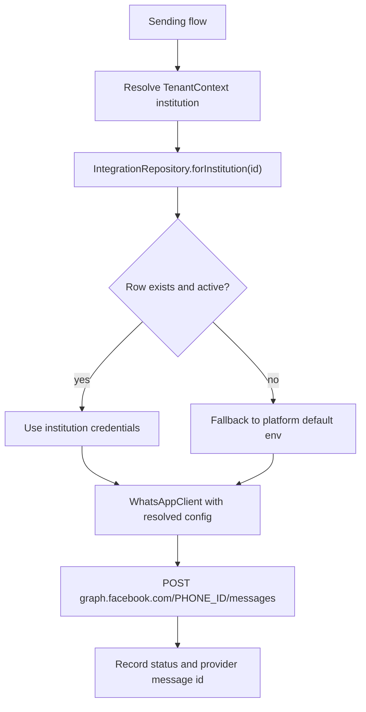
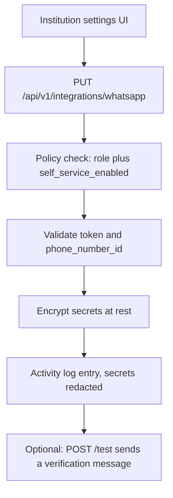

# Implementation Plan — Per-Institution WhatsApp Integration

Status: proposed. Not started.
Related: `apps/api/app/Services/WhatsApp/WhatsAppClient.php`,
`apps/api/config/reminders.php`, `apps/web/src/app/dashboard/settings/`.

---

## 1. Problem

WhatsApp currently reads one global credential set from `.env`
(`WHATSAPP_TOKEN`, `WHATSAPP_PHONE_NUMBER_ID`). Every institution therefore
shares one Meta WhatsApp Business number. Institutions each own their own Meta
Business account and want to send from their own number with their own branding
and quota.

Goal: let each institution store and manage its own WhatsApp Cloud API
credentials, resolved at send time, without leaking or exposing secrets.

Today only 3 institutions / 10 campuses exist, but the design must not assume a
small number.

---

## 2. Permission decision (the important question)

### Recommendation: institution-scoped self-service, gated by a platform policy

Do **not** give this to the Product Manager only, and do **not** give it to
`institution_head`.

| Role | View | Edit credentials | Test send | Notes |
| --- | --- | --- | --- | --- |
| `platform_admin` | yes | yes, any institution | yes | Can also toggle self-service policy |
| `it_administrator` | yes | yes, own institution | yes | **Primary owner** — this is an IT/config task |
| `campus_admin` | yes | yes, own institution | yes | Practical fallback for single-campus institutions |
| `institution_head` | yes | **no** | no | Stays read-only by design; sees status only |
| everyone else | no | no | no | |

Rationale:

- `institution_head` is explicitly defined as view-only across campuses
  ("Cannot create, edit or delete records"). Granting write would break that
  contract and the existing RBAC expectations.
- `it_administrator` already owns "user accounts, devices, IT change requests
  and audit visibility" and holds `setting.view`. WhatsApp API credentials are
  an IT secret, so this is the natural owner.
- `campus_admin` runs the campus and holds `setting.*` today; allowing them
  keeps small institutions working without provisioning a second account.
- `platform_admin` keeps break-glass access and, critically, controls **whether
  self-service is allowed at all** per institution.

### New permission module

Add to `apps/api/config/rbac.php`:

```php
'integration' => ['view', 'edit', 'test'],
```

Grant policy:

- `platform_admin`: `integration.*`
- `campus_admin`: `integration.*`
- `it_administrator`: `integration.*`
- `institution_head`: `integration.view`
- all other roles: nothing

### Self-service gate

Add a platform-controlled flag per institution, default **off**, stored in
`institution_integrations.self_service_enabled`:

- Off: only `platform_admin` can edit; institution roles see status + "managed
  by platform".
- On: `it_administrator` / `campus_admin` can edit their own institution.

This answers "product manager only, or the institute?" with **both, policy
controlled**: the platform decides per tenant, and the tenant configures itself
once enabled. Default off means no institution can silently start spending on a
misconfigured number.

---

## 3. Architecture



Key change: `WhatsAppClient::fromConfig()` becomes
`WhatsAppClient::forInstitution(?int $institutionId)` and reads the database
first, then falls back to `config('reminders.whatsapp')`.



---

## 4. Data model

New table `institution_integrations` (single row per institution; multi-provider
ready via `provider` column):

| Column | Type | Notes |
| --- | --- | --- |
| `id` | bigint | |
| `institution_id` | FK, cascade | unique with `provider` |
| `provider` | string(32) | `whatsapp` for now |
| `is_active` | boolean | master on/off |
| `self_service_enabled` | boolean | platform-controlled, default false |
| `phone_number_id` | string(64) | Meta business phone number id |
| `business_account_id` | string(64) nullable | WABA id, useful for templates |
| `token` | text encrypted | permanent system-user token |
| `app_secret` | text encrypted nullable | for webhook signature checks |
| `webhook_verify_token` | string nullable | Meta webhook handshake |
| `default_country_code` | string(4) | e.g. `92` |
| `template_name` | string nullable | approved template for cold sends |
| `template_language` | string(8) nullable | e.g. `en_US` |
| `last_verified_at` | timestamp nullable | set by test send |
| `last_error` | text nullable | last provider error, redacted |
| `timestamps`, `softDeletes` | | |

Rules:

- `token`, `app_secret` use the `encrypted` cast, exactly like
  `SsoProvider::client_secret`.
- Resource never returns secrets. Expose `has_token`, `has_app_secret`, and a
  masked hint (last 4 chars) only.
- Activity log redacts secrets (`logOnly` excludes them).

### Template gap (P0 for real delivery)

The current client only sends `type: text`. Meta blocks free-form text outside
the 24-hour customer service window, so cold fee reminders will fail even with
valid credentials. The plan therefore includes approved-template support:

- `template_name` / `template_language` on the integration row.
- Client sends `type: template` with ordered body parameters when a template is
  configured, otherwise falls back to text (works for reply-within-24h only).
- Surface a clear failure reason when Meta rejects for "outside window".

---

## 5. Phases

Each phase ends with `php -l`, affected `php artisan test` filters,
`./vendor/bin/pint`, and web `tsc --noEmit` + `eslint` + `next build` as
applicable. Commit and push to `master` per the standing workflow.

### Phase A — Data model and repository

Files:

- `database/migrations/<date>_create_institution_integrations_table.php`
- `app/Models/InstitutionIntegration.php` (BelongsToInstitution, LogsActivity,
  encrypted casts, secrets hidden)
- `app/Services/Integrations/IntegrationRepository.php` —
  `forInstitution(?int): ?InstitutionIntegration`, cached per request
- `app/Http/Resources/InstitutionIntegrationResource.php` (no secrets)

Tests: `tests/Feature/InstitutionIntegrationTest.php` — tenant isolation,
encrypted at rest, resource hides secrets.

### Phase B — Per-institution client resolution

Files:

- `app/Services/WhatsApp/WhatsAppClient.php` — add
  `forInstitution(?int $institutionId)`; keep `fromConfig()` as the platform
  fallback
- `app/Services/Reminders/ReminderService.php` — resolve gateway per reminder's
  `institution_id`, not per global config
- `app/Services/Notifications/NotificationService.php` — same
- `app/Providers/AppServiceProvider.php` — gateway binding becomes a factory
  keyed by institution instead of a single instance

Tests: extend `WhatsAppGatewayTest` — institution A's token used for A's
reminders, fallback used when no row, inactive row falls back, no cross-tenant
credential use.

### Phase C — Template support

Files:

- `WhatsAppClient::sendTemplate()` with ordered parameters
- Reminder/notification gateways choose template when configured
- Failure reason mapping for Meta error codes (131047 window, 131026
  undeliverable, 132000/132001 template errors)

Tests: fake Graph responses for template payload shape and each error mapping.

### Phase D — API endpoints

Files:

- `app/Http/Controllers/Api/IntegrationController.php`
  - `GET  /api/v1/integrations/whatsapp` (view)
  - `PUT  /api/v1/integrations/whatsapp` (edit)
  - `POST /api/v1/integrations/whatsapp/test` (test)
  - `POST /api/v1/integrations/whatsapp/toggle` (platform only, self-service)
- `app/Http/Requests/*` validation: token length, `phone_number_id` numeric-ish,
  country code digits, template fields
- Routes in `routes/api.php` inside the `auth:sanctum`,`tenant` group with new
  permission middleware

Policy enforcement:

- `integration.edit` plus (`platform_admin` OR
  `self_service_enabled = true` and user institution matches)
- `toggle` restricted to `platform_admin` (validated by role, not just
  permission)

Tests: `tests/Feature/IntegrationEndpointTest.php` — 403 when self-service off,
403 for `institution_head` write, 200 for IT admin when on, tenant cannot touch
another institution, secret never echoed.

### Phase E — Web UI

Files:

- `apps/web/src/app/dashboard/settings/integrations/whatsapp/page.tsx`
- `apps/web/src/components/integrations/WhatsAppIntegrationForm.tsx`
  - Fields: active toggle, phone number id, WABA id, token (write-only, with
    "replace" affordance), country code, template name/language
  - Status card: last verified, last error, "Test connection" button
  - Read-only mode banner when self-service is disabled
- `SettingsTabs.tsx` — add tab gated on `integration.view`
- `settings/page.tsx` — add hub card
- `lib/nav.ts` — no top-level nav change; keep under Settings
- i18n keys in `packages/i18n/src/locales/en.ts`, regenerate `index.ts`

Behavior notes:

- Secret inputs are never prefilled; placeholder shows
  `Saved (ending 1234)` and submission omits the field unless changed.
- Saving triggers `config`-independent refresh; no redeploy needed.

### Phase F — Webhook and delivery receipts (optional, recommended)

Files:

- `app/Http/Controllers/Api/WhatsAppWebhookController.php`
  - `GET /api/v1/webhooks/whatsapp` verify handshake (per-institution token
    lookup by `phone_number_id`)
  - `POST /api/v1/webhooks/whatsapp` signature check with `app_secret`, store
    delivery status and inbound replies
- New table or columns for message status events
- Map provider statuses to `FeeReminder.status` / `AppNotification.status`

Rationale: without receipts, "Sent" only means Meta accepted the request, not
that the guardian received it. Needed for support and for detecting bad numbers.

### Phase G — Docs and rollout

- `docs/RUNBOOK.md`: per-institution setup, credential rotation, self-service
  policy, template approval flow
- `docs/SPECIFICATION.md`: update WhatsApp section
- Migration of existing env credentials: optional one-time command to seed the
  platform-default institution row (kept as fallback, not required)
- Rollout: ship with self-service off; enable per institution after a supervised
  test send

---

## 6. Security checklist

- Secrets encrypted at rest; never in API responses, logs, or activity log.
- `hidden` on model attributes plus `logOnly` audit fields excluding secrets.
- No secret in the web bundle; write-only round trip.
- Rate limit test-send (reuse `throttle:sensitive`).
- Tenant isolation enforced by `BelongsToInstitution` global scope and explicit
  policy checks.
- Two-factor already required for `campus_admin`; add `it_administrator` to
  `RoleName::twoFactorRequired()` since it now holds secrets.

---

## 7. Open decisions

1. Default `self_service_enabled`: propose **off** for safety.
2. Who can edit when self-service is off: propose platform only, with an
   optional per-institution "assisted setup" note field.
3. WABA sharing model: if institutions are added as partners under one Meta app,
   they supply their own `phone_number_id` + token; if each owns a full app, we
   also need their `app_secret` for webhooks. Plan supports both columns.
4. Template ownership: institution creates templates in their WABA; we store the
   name and language only.

---

## 8. Estimated scope

| Phase | Backend | Web | Tests |
| --- | --- | --- | --- |
| A model/repo | small | none | medium |
| B resolution | medium | none | medium |
| C templates | medium | none | medium |
| D endpoints | medium | none | large |
| E UI | none | large | small |
| F webhook | large | none | large |
| G docs | small | small | none |

Minimum viable self-service = A + B + D + E (platform-only fallback still works
if D/E are deferred). Templates (C) are required before cold fee reminders over
WhatsApp will actually deliver.
